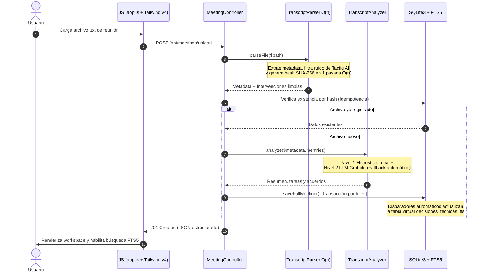

<div align="center">

# Unitrax · App 

**Plataforma inteligente para convertir transcripciones `.txt` de reuniones en minutas ejecutivas, tareas accionables y decisiones técnicas indexadas con SQLite FTS5.**

[](https://www.php.net/)
[](https://codeigniter.com/)
[-003b57.svg?style=flat-square&logo=sqlite&logoColor=white)](https://www.sqlite.org/fts5.html)
[](https://tailwindcss.com/)
[-10b981.svg?style=flat-square&logo=githubactions&logoColor=white)](#-suite-de-pruebas-automatizadas)
[](LICENSE)

[Características](#-características-principales) •
[Inicio Rápido](#-inicio-rápido-en-menos-de-5-minutos) •
[Arquitectura](#-arquitectura-del-sistema) •
[Variables de Entorno](#-variables-de-entorno) •
[Documentación](#-documentación-adicional) •
[API REST](#-resumen-de-la-api-rest)

</div>

---

## 💡 ¿Por qué Unitrax?

En los equipos de tecnología y producto, cientos de acuerdos críticos quedan sepultados en llamadas de Zoom, Google Meet o Microsoft Teams. Las herramientas de transcripción automática generan archivos de texto plano desestructurados con ruido promocional que nadie vuelve a leer.

**Unitrax** resuelve este problema procesando archivos `.txt` en una sola pasada $O(n)$ sin dependencias pesadas:
1. **Genera una Minuta Ejecutiva** con resumen formal y métricas de duración y participantes.
2. **Extrae Tareas y Compromisos** con su responsable, minuto exacto (`MM:SS`) y estado interactivo.
3. **Indexa Decisiones Técnicas y Bloqueos** en un motor de búsqueda de texto completo **SQLite FTS5** con algoritmo de ranking **BM25** y expansión semántica de sinónimos técnicos en español.
4. **Motor de IA Híbrido:** Funciona **100% en local y sin costo** mediante heurísticas lingüísticas nativas, o enriquecido con LLMs gratuitos (**Google Gemini**, **Groq Cloud** u **Ollama local**).

```
┌────────────────────────────────────────────────────────────────────────────────────────┐
│                                 ESPACIO DE TRABAJO SAAS                                │
├──────────────────────┬──────────────────────────────────────────┬──────────────────────┤
│  HISTORIAL Y SUBIDA  │            ÁREA CENTRAL (TABS)           │  VISOR CRONOLÓGICO   │
│                      │                                          │                      │
│ • Sincronización     │ [Minuta Ejecutiva & Tareas] [Decisiones] │ 00:00 Vanesa M.      │
│   Técnica (7 min)    │                                          │ "Hola Alex..."       │
│ • Kickoff Q4         │ • Resumen Ejecutivo Editable (inline)    │                      │
│ • Refactor DB        │ • Progreso de Tareas (Barra interactiva) │ 01:39 Vanesa M.      │
│                      │ • Tareas extraídas con responsable y     │ "Plantilla WhatsApp" │
│ [+ Subir .txt]       │   minuto [01:39] [05:01]                 │ [+ Tarea] [+ Dec.]   │
│ [⚡ Cargar Muestra]   │ • Buscador FTS5 con chips semánticos     │                      │
│                      │ • Exportación Markdown (.md) en 1 clic   │ 02:50 Alexander P.   │
│ [Tema: Claro/Oscuro] │                                          │ "Antes del pago..."  │
└──────────────────────┴──────────────────────────────────────────┴──────────────────────┘
```

---

## ✨ Características Principales

### 🚀 Ingesta Determinista en $O(n)$ e Idempotencia
- **Lectura eficiente con `SplFileObject`:** Procesa archivos grandes línea por línea sin desbordar la memoria RAM.
- **Límite de seguridad estricto:** Cota máxima de `MAX_LINES = 50000` para garantizar prevención total de bucles infinitos.
- **Idempotencia por Hash SHA-256:** Evita duplicar reuniones si el mismo archivo se sube repetidamente.
- **Filtro anti-ruido automático:** Detecta y purga frases promocionales autogeneradas por extensiones (ej. Tactiq AI).

### 📋 Módulo 1: Gestor de Minutas y Extracción Automática de Tareas
- Detección de compromisos usando verbos de acción en español (*"tendrían que crear"*, *"voy a exponer"*, *"nos tocaría hacer"*).
- Asignación inteligente del participante responsable según el contexto del diálogo.
- Vínculo bidireccional: un clic en la marca de tiempo `MM:SS` salta y resalta la intervención original.
- Gestión de estados en tiempo real: `Pendiente`, `En progreso` y `Completada`.

### 🔍 Módulo 2: Buscador Semántico de Decisiones Técnicas
- **SQLite FTS5 + BM25:** Búsqueda ultrarrápida de texto completo en local sincronizada mediante disparadores (*triggers*) en base de datos.
- **Expansión Semántica:** Encuentra registros relevantes buscando conceptos afines en español (por ejemplo, al buscar `limpieza`, el motor busca automáticamente `rutina`, `registros`, `basuras` y `campo de estados`).
- **Filtros combinables:** Por categoría (`Decisión`, `Bloqueo`, `Arquitectura`), participante o alcance (*Esta reunión* vs *Todas las reuniones*).
- **Acceso directo con teclado:** Pulsa `Ctrl + K` (o `Cmd + K`) desde cualquier parte para abrir el buscador.

### 🧠 Inteligencia Artificial Híbrida de Dos Niveles
- **Nivel 1 (Base Determinista - 100% Gratuito y Offline):** Sin llamadas de red, sin costos y con respuesta en $<10\text{ ms}$. Cero alucinaciones.
- **Nivel 2 (LLM Gratuito Opcional):** Compatible con **Google Gemini Free Tier** (`gemini-2.5-flash`), **Groq Cloud Free Tier** (`llama-3.3-70b-versatile`) u **Ollama en local** (`llama3.2`).
- **Degradación Elegante (*Graceful Fallback*):** Si se agota la cuota gratuita (HTTP 429) o no hay conexión, el sistema conmuta automáticamente al analizador local sin interrumpir al usuario.

### 🔐 Autenticación Flexible y Segura
- Soporte para **Sesión tradicional** (CodeIgniter 4) y tokens **JWT HS256** nativos (sin librerías pesadas).
- Integración oficial con **Google Identity Services** (OAuth 2.0).
- Acceso rápido con **Cuenta Demo de 1 clic** preconfigurada para pruebas locales inmediatas.

### 🎨 Diseño y Accesibilidad (UI/UX)
- Diseñado con **Tailwind CSS v4** (fuentes `Manrope` para interfaz y `Geist Mono` para marcas de tiempo y métricas).
- Tema oscuro y claro nativo con persistencia en `localStorage` y **cero destellos molestos (FOUC)**.
- Modales nativos `<dialog>` accesibles por teclado (`Escape` para cerrar).
- Exportación de la minuta completa a formato Markdown (`.md`) para importar directamente en Jira, Linear o Notion.

---

## 🛠️ Stack Tecnológico

| Capa | Tecnología | Justificación Técnica |
|---|---|---|
| **Lenguaje** | PHP 8.1+ | Tipado estricto, funciones criptográficas nativas y compatibilidad moderna. |
| **Backend Framework** | CodeIgniter 4.4.8 | MVC minimalista, arranque ultrarrápido ($<15\text{ ms}$) y consumo mínimo de RAM. |
| **Base de Datos** | SQLite3 + FTS5 | Sin servidor externo que configurar, tablas virtuales FTS5 con ranking `bm25()`. |
| **Frontend** | Vanilla ES6+ & Tailwind v4 | Cero frameworks pesados; uso de `<dialog>`, `IntersectionObserver` y `AbortController`. |
| **Tipografía** | Manrope & Geist Mono | Lectura ejecutiva impecable combinada con precisión monoespaciada para timestamps. |
| **Seguridad** | JWT HS256 + Google OAuth | RFC 7519 nativo con `hash_hmac` y validación resistente a ataques de tiempo (`hash_equals`). |
| **Pruebas** | PHPUnit 9.6 | Base de datos de pruebas en memoria (`:memory:`) con ejecución en $<4$ segundos. |

---

## 📋 Requisitos Previos

Asegúrate de contar con lo siguiente en tu entorno de desarrollo o servidor:

- **PHP 8.1 o superior** con las siguientes extensiones habilitadas en `php.ini`:
  - `sqlite3` y `pdo_sqlite`
  - `curl` (para llamadas al modelo de IA remoto)
  - `intl`
  - `mbstring`
  - `json`
- **Composer** (v2.x) para dependencias de PHP.
- **Node.js (v18+) y npm** para compilar el archivo CSS de Tailwind v4.
- Servidor web local: **WAMP**, **XAMPP**, **Laragon**, **Nginx** o el servidor embebido `php spark serve`.

---

## ⚡ Inicio Rápido en Menos de 5 Minutos

### 1. Clonar el Repositorio
```bash
git clone https://github.com/tu-usuario/App-transcripciones.git
cd App-transcripciones
```

### 2. Instalar Dependencias de PHP
```bash
composer install
```

### 3. Configurar el Entorno
Copia la plantilla de entorno:
```bash
cp env .env
```

Edita el archivo `.env` para ajustar la URL base según tu servidor local:
```ini
CI_ENVIRONMENT = development
app.baseURL = 'http://localhost/App-transcripciones/public/'
```
*(Si usas el comando `php spark serve`, define `app.baseURL = 'http://localhost:8080/'`).*

### 4. Ejecutar Migraciones y Datos Semilla
Ejecuta el comando Spark para crear la base de datos SQLite y el usuario administrador inicial:
```bash
php spark migrate
```
> La base de datos se generará automáticamente en `writable/database/transcripciones.db`.

### 5. Compilar los Estilos con Tailwind CSS v4
```bash
npm install
npm run build
```

### 6. Iniciar la Aplicación

#### Opción A: Con el servidor de desarrollo de CodeIgniter
```bash
php spark serve
```
Abre tu navegador en: [http://localhost:8080](http://localhost:8080)

#### Opción B: Con WAMP / XAMPP / Laragon
Coloca el proyecto en `c:\wamp64\www\App-transcripciones` y accede a:
[http://localhost/App-transcripciones/public/](http://localhost/App-transcripciones/public/)

### 7. Iniciar Sesión y Cargar Prueba
- Utiliza la **cuenta demo preconfigurada**:
  - **Correo:** `admin@transcripciones.local`
  - **Contraseña:** `Admin123*`
- Una vez dentro, haz clic en el botón lateral **⚡ Cargar Transcripción Real de Muestra** para procesar instantáneamente el archivo de prueba `.agents/resources/formato-transcripcion/formato-real.txt`.

---

## ⚙️ Variables de Entorno

Configuración completa disponible en el archivo `.env`:

| Variable | Tipo | Valor por Defecto | Descripción |
|---|---|---|---|
| `CI_ENVIRONMENT` | String | `development` | Entorno de ejecución: `development` o `production`. |
| `app.baseURL` | String | `http://localhost/App-transcripciones/public/` | URL pública de la aplicación. |
| `database.default.database` | Path | `writable/database/transcripciones.db` | Ruta del archivo de base de datos SQLite3. |
| `ai.provider` | String | `gemini` | Motor de IA: `gemini`, `groq`, `ollama` o `local`. |
| `ai.apiKey` | String | `''` (vacío) | API Key gratuita para Gemini o Groq. Si está vacía, usa fallback local. |
| `ai.model` | String | `gemini-2.5-flash` | Modelo de IA (`gemini-2.5-flash`, `llama-3.3-70b-versatile`, `llama3.2`). |
| `ai.ollamaBaseUrl` | URL | `http://localhost:11434` | URL base cuando se utiliza Ollama local. |
| `ai.timeoutSeconds` | Integer | `8` | Tiempo máximo en segundos para la respuesta de IA remota. |
| `auth.jwtSecret` | String | `app-transcripciones-jwt-secret...` | Clave secreta para la firma de tokens JWT (HS256). |
| `auth.jwtTtlSeconds` | Integer | `28800` (8 horas) | Tiempo de validez del token de acceso en segundos. |
| `auth.googleClientId` | String | `''` (vacío) | Client ID de Google Identity Services para OAuth 2.0. |

---

## 📁 Estructura del Proyecto

```
App-transcripciones/
├── app/
│   ├── Config/
│   │   ├── AI.php                   # Configuración del motor de IA híbrido
│   │   ├── Auth.php                 # Claves JWT y credenciales Google OAuth
│   │   ├── Extraction.php           # Diccionario lingüístico de tareas y sinónimos
│   │   └── Routes.php               # Definición centralizada de rutas MVC
│   ├── Controllers/
│   │   ├── AuthController.php       # Login, registro, Google OAuth y JWT
│   │   ├── MeetingController.php    # Ingesta .txt, edición inline y exportación .md
│   │   ├── SearchController.php     # Buscador semántico SQLite FTS5 (Módulo 2)
│   │   └── TaskController.php       # Gestor de tareas y estados (Módulo 1)
│   ├── Database/
│   │   └── Migrations/              # Migración con tablas, FTS5 y triggers
│   ├── Filters/
│   │   └── AuthFilter.php           # Middleware de protección por sesión y JWT
│   ├── Libraries/
│   │   ├── AI/
│   │   │   ├── FreeModelClient.php  # Conector HTTP nativo cURL a Gemini/Groq/Ollama
│   │   │   └── TranscriptAnalyzer.php# Orquestador del análisis con fallback local
│   │   ├── Auth/
│   │   │   ├── GoogleOAuthClient.php# Cliente para Google Identity Services
│   │   │   └── JwtManager.php       # Gestor de JWT RFC 7519 nativo (HS256)
│   │   └── TranscriptParser.php     # Parser determinista O(n) con SplFileObject
│   ├── Models/
│   │   ├── DecisionModel.php        # Consultas FTS5 y expansión semántica
│   │   ├── MeetingModel.php         # Inserciones transaccionales por lotes
│   │   ├── TaskModel.php            # Modelo de tareas y estados de la minuta
│   │   └── UserModel.php            # Usuarios y credenciales seguras
│   └── Views/
│       ├── auth/login.php           # Landing page + Acceso integrado
│       ├── dashboard/index.php      # Workspace SaaS principal (3 columnas)
│       └── errors/html/error_404.php# Página 404 de marca
├── docs/                            # Documentación técnica exhaustiva
│   ├── API.md                       # Especificación de endpoints REST
│   ├── ARCHITECTURE.md              # Diagramas y decisiones de diseño
│   ├── AI_PIPELINE.md               # Guía del motor de IA en 2 niveles
│   └── CHANGELOG.md                 # Registro histórico de versiones
├── public/                          # Raíz pública del servidor web
│   ├── assets/                      # CSS compilado de Tailwind v4 y JS
│   └── index.php                    # Front Controller de CodeIgniter 4
├── resources/css/app.css            # Hoja de estilos fuente Tailwind CSS v4
├── tests/                           # Pruebas automatizadas con PHPUnit
│   └── unit/AppTranscripcionesTest.php
├── writable/                        # Directorio con permisos de escritura
│   └── database/transcripciones.db  # Base de datos local SQLite3
├── AGENTS.md                        # Reglas y roles de los agentes de desarrollo
├── llms.txt                         # Resumen estructurado para herramientas de IA
└── README.md                        # Esta guía
```

---

## 🏛️ Arquitectura del Sistema

### Ciclo de Solicitud y Procesamiento



---

## 🔌 Resumen de la API REST

Para consultar la referencia completa con ejemplos de petición y respuesta, revisa [docs/API.md](docs/API.md).

| Método | Endpoint | Descripción | Autenticación |
|---|---|---|:---:|
| `POST` | `/auth/login` | Inicia sesión con correo y contraseña | No |
| `POST` | `/auth/register` | Crea una nueva cuenta de usuario | No |
| `POST` | `/auth/google` | Inicio de sesión con Google Identity Services | No |
| `POST` | `/auth/logout` | Cierra la sesión activa | Sí |
| `GET` | `/api/meetings` | Lista las reuniones del usuario | Sí |
| `POST` | `/api/meetings/upload` | Sube y procesa una transcripción `.txt` en $O(n)$ | Sí |
| `GET` | `/api/meetings/:id` | Obtiene el detalle completo de una reunión | Sí |
| `PATCH` | `/api/meetings/:id` | Edita el título o resumen ejecutivo | Sí |
| `GET` | `/api/meetings/:id/export` | Descarga la minuta en formato Markdown (`.md`) | Sí |
| `DELETE` | `/api/meetings/:id` | Elimina la reunión y sus registros en cascada | Sí |
| `POST` | `/api/tasks` | Crea una tarea vinculada a la minuta (Módulo 1) | Sí |
| `PATCH` | `/api/tasks/:id` | Actualiza estado (`pendiente`, `en_progreso`, `completada`) | Sí |
| `DELETE` | `/api/tasks/:id` | Elimina una tarea de la minuta | Sí |
| `GET` | `/api/decisions/search` | Búsqueda semántica SQLite FTS5 `bm25()` (Módulo 2) | Sí |
| `POST` | `/api/decisions` | Registra manualmente una decisión o bloqueo | Sí |
| `DELETE` | `/api/decisions/:id` | Elimina una decisión del índice de búsqueda | Sí |

---

## 🧪 Suite de Pruebas Automatizadas

La aplicación cuenta con una suite integral de pruebas en `tests/unit/AppTranscripcionesTest.php` construida sobre PHPUnit y el trait de base de datos en memoria (`:memory:`) de CodeIgniter 4:

```bash
# Ejecutar todas las pruebas del proyecto
vendor\bin\phpunit

# Ejecutar únicamente la suite del parser, tareas y búsqueda FTS5
vendor\bin\phpunit tests/unit/AppTranscripcionesTest.php
```

### Qué verifican las pruebas:
- ✅ **Lectura en una sola pasada:** Ingesta de `formato-real.txt` y extracción exacta de duración, participantes y URL original.
- ✅ **Filtrado de ruido:** Eliminación comprobada de mensajes promocionales de Tactiq AI.
- ✅ **Idempotencia:** Rechazo de duplicados calculando el hash SHA-256.
- ✅ **Ciclo de vida de tareas (Módulo 1):** Creación, asignación y cambio de estados.
- ✅ **Búsqueda FTS5 (Módulo 2):** Coincidencia directa por término técnico y coincidencia por sinónimos semánticos expandidos.
- ✅ **Filtro de seguridad AuthFilter:** Validación de cabeceras JWT y bloqueo de accesos no autorizados.

---

## 🚀 Despliegue en Producción

### 1. Despliegue en WAMP / Servidor Windows
1. Asegúrate de que `mod_rewrite` esté activo en Apache (`httpd.conf`).
2. Configura un Virtual Host apuntando al directorio `public/`:
   ```apache
   <VirtualHost *:80>
       ServerName unitrax.local
       DocumentRoot "c:/wamp64/www/App-transcripciones/public"
       <Directory "c:/wamp64/www/App-transcripciones/public">
           AllowOverride All
           Require all granted
       </Directory>
   </VirtualHost>
   ```
3. En el archivo `.env`, define:
   ```ini
   CI_ENVIRONMENT = production
   app.baseURL = 'http://unitrax.local/'
   ```

### 2. Despliegue en Linux (Ubuntu/Debian + Nginx + PHP-FPM)
Asegúrate de otorgar permisos de escritura al directorio `writable/`:
```bash
sudo chown -R www-data:www-data writable/
sudo chmod -R 775 writable/
```

Ejemplo de configuración de Nginx:
```nginx
server {
    listen 80;
    server_name transcripciones.tu-dominio.com;
    root /var/www/App-transcripciones/public;
    index index.php index.html;

    location / {
        try_files $uri $uri/ /index.php?$query_string;
    }

    location ~ \.php$ {
        include snippets/fastcgi-php.conf;
        fastcgi_pass unix:/var/run/php/php8.2-fpm.sock;
    }

    location ~ /\. {
        deny all;
    }
}
```

---

## ❓ Preguntas Frecuentes y Solución de Problemas

### 1. Error: `Driver "SQLite3" is not supported or not enabled`
Abre tu archivo `php.ini` y asegúrate de descomentar las líneas:
```ini
extension=sqlite3
extension=pdo_sqlite
```
Reinicia el servidor web (Apache o PHP-FPM) tras guardar los cambios.

### 2. Error: `database table is locked` o `busy timeout`
SQLite maneja concurrencia bloqueando el archivo durante escrituras. Unitrax ya tiene configurado `busyTimeout = 2000` (2 segundos) en `app/Config/Database.php` y realiza todas las escrituras en una única transacción atómica por lote para evitar contención.

### 3. ¿Cómo cambio el modelo de IA gratuito?
En tu archivo `.env`, simplemente ajusta las variables `ai.provider`, `ai.apiKey` y `ai.model`. Si no colocas ninguna clave, el sistema seguirá funcionando normalmente mediante el analizador heurístico local.

---

## 📚 Documentación Adicional

Para profundizar en los aspectos internos del sistema, consulta los manuales en la carpeta `docs/`:

- 📖 [docs/API.md](docs/API.md): Documentación detallada de endpoints REST, esquemas de entrada y salida.
- 🏗️ [docs/ARCHITECTURE.md](docs/ARCHITECTURE.md): Diagramas de flujo, disparadores FTS5 y principios de ingeniería de software.
- 🧠 [docs/AI_PIPELINE.md](docs/AI_PIPELINE.md): Guía del motor de IA híbrido y configuración de proveedores gratuitos.
- 📜 [docs/CHANGELOG.md](docs/CHANGELOG.md): Historial de versiones y cambios del proyecto.
- 🤖 [llms.txt](llms.txt): Resumen técnico estructurado para herramientas y agentes de IA.

---

## 📄 Licencia

Este proyecto está liberado bajo la licencia **MIT**. Puedes usarlo, modificarlo y distribuirlo libremente para proyectos personales o comerciales. Consulta el archivo [LICENSE](LICENSE) para más detalles.
