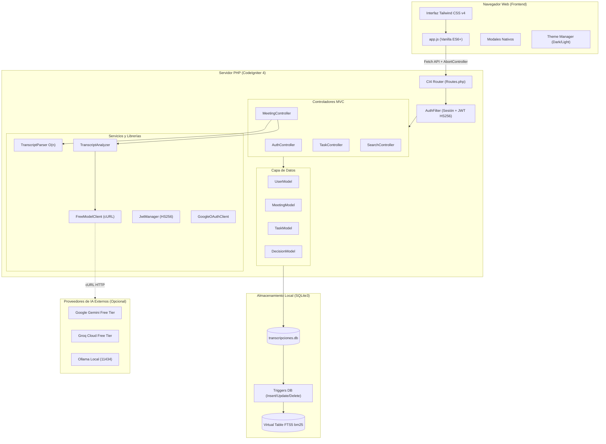
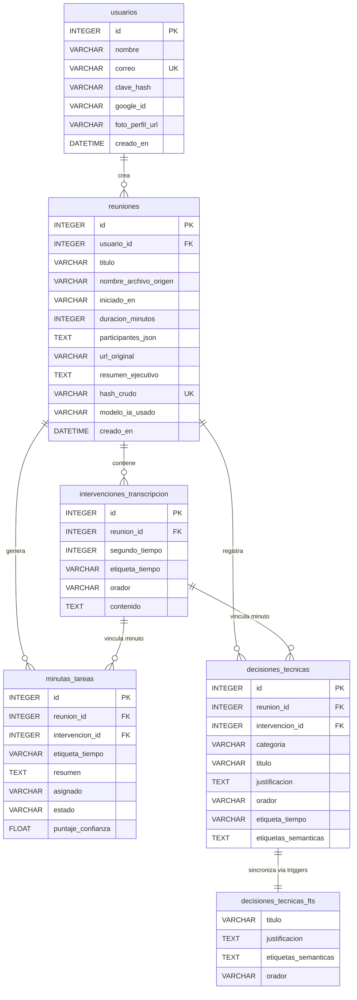
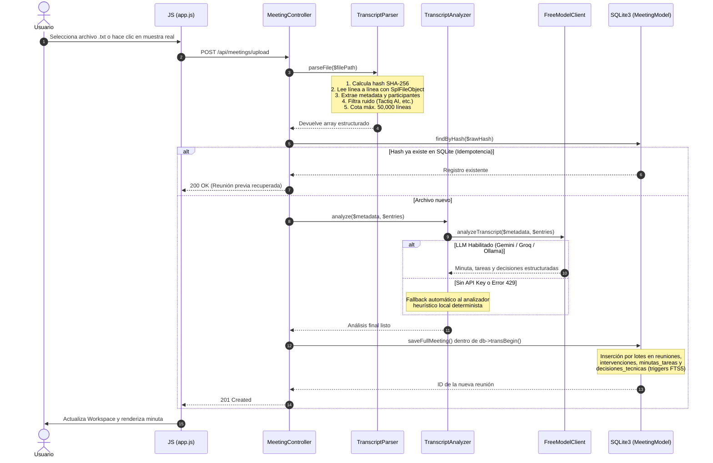

# Arquitectura del Sistema · Unitrax (App-Transcripciones)

Documento de referencia técnica sobre las decisiones de diseño, flujo de datos, esquema de base de datos y patrones de software implementados en **Unitrax**.

---

## 1. Principios de Arquitectura

El proyecto sigue una filosofía rigurosa orientada a rendimiento predecible, simplicidad operativa y bajo consumo de recursos:

1. **Regla Ponytail (Full Mode):**
   - Máximo aprovechamiento de las funciones nativas de PHP 8 (`hash_hmac`, `hash_file`, `password_hash`, `SplFileObject`, `cURL`).
   - Cero dependencias externas innecesarias: no se instalan SDKs pesados para JWT ni para clientes de IA.
   - Todo el frontend corre sobre APIs web nativas del navegador (`<dialog>`, `<details>`, `IntersectionObserver`, `AbortController`, `DocumentFragment`, `localStorage`).

2. **Cotas Superiores y Protección Anti-Bucles:**
   - Lectura de archivos acotada a `MAX_LINES = 50000` para garantizar que ningún archivo mal formado cause bloqueos de memoria o bucles infinitos.
   - Procesamiento en una sola pasada $O(n)$: metadata de cabecera, sanitización de codificación UTF-8, filtrado de ruido y extracción de intervenciones se realizan en un único ciclo lineal.
   - Consultas por lotes con `insertBatch(..., null, 500)` dentro de transacciones SQLite; prohibidas las consultas individuales dentro de bucles ($N+1$).

3. **Arquitectura Híbrida de Inteligencia Artificial:**
   - **Nivel 1 (Local Determinista):** Extracción instantánea ($<10\text{ ms}$) mediante el catálogo heurístico `Config\Extraction`. Cero costo, $100\%$ disponible sin conexión a internet y cero alucinaciones.
   - **Nivel 2 (LLM Gratuito Opcional):** Enriquecimiento contextual mediante APIs gratuitas (Google Gemini Free Tier, Groq Cloud Free Tier u Ollama local) con degradación elegante (*graceful fallback*) automática ante límites de cuota (HTTP 429) o fallos de red.

---

## 2. Diagrama General de Arquitectura



---

## 3. Esquema de Base de Datos y Motor FTS5

El sistema utiliza **SQLite3** con la extensión **FTS5** habilitada de forma nativa. La base de datos se almacena en el archivo persistente `writable/database/transcripciones.db`.

### Diagrama Entidad-Relación (ERD)



### Sincronización Automática con FTS5

Para garantizar que el índice de texto completo nunca quede desactualizado respecto a la tabla principal, la migración `CreateInitialSchema` registra tres disparadores (*triggers*) en SQLite:

```sql
-- Trigger de Inserción
CREATE TRIGGER trg_decisiones_ai AFTER INSERT ON decisiones_tecnicas BEGIN
    INSERT INTO decisiones_tecnicas_fts(rowid, titulo, justificacion, etiquetas_semanticas, orador)
    VALUES (new.id, new.titulo, new.justificacion, new.etiquetas_semanticas, new.orador);
END;

-- Trigger de Borrado
CREATE TRIGGER trg_decisiones_ad AFTER DELETE ON decisiones_tecnicas BEGIN
    INSERT INTO decisiones_tecnicas_fts(decisiones_tecnicas_fts, rowid, titulo, justificacion, etiquetas_semanticas, orador)
    VALUES ('delete', old.id, old.titulo, old.justificacion, old.etiquetas_semanticas, old.orador);
END;

-- Trigger de Actualización
CREATE TRIGGER trg_decisiones_au AFTER UPDATE ON decisiones_tecnicas BEGIN
    INSERT INTO decisiones_tecnicas_fts(decisiones_tecnicas_fts, rowid, titulo, justificacion, etiquetas_semanticas, orador)
    VALUES ('delete', old.id, old.titulo, old.justificacion, old.etiquetas_semanticas, old.orador);
    INSERT INTO decisiones_tecnicas_fts(rowid, titulo, justificacion, etiquetas_semanticas, orador)
    VALUES (new.id, new.titulo, new.justificacion, new.etiquetas_semanticas, new.orador);
END;
```

---

## 4. Pipeline de Ingesta y Procesamiento



---

## 5. Arquitectura del Frontend

El cliente web no utiliza dependencias pesadas tipo React, Vue o Webpack. Está construido con JavaScript moderno (ES6+) estructurado en un único ciclo de vida de aplicación:

- **Componentes modales nativos:** Uso de la etiqueta `<dialog>` de HTML5 con métodos nativos `.showModal()` y `.close()`, garantizando accesibilidad de teclado (`Escape`) y bloqueo de foco.
- **Cancelación de peticiones redundantes:** El buscador semántico y los filtros de transcripción implementan un patrón `debounce(250ms)` combinado con `AbortController`. Si el usuario sigue escribiendo, la petición HTTP anterior en tránsito se cancela inmediatamente.
- **Renderizado por lotes:** Las intervenciones largas se insertan en el DOM mediante `DocumentFragment`, reduciendo al mínimo los reflujos (*reflows*) y repintados (*repaints*) de la página.
- **Cero FOUC (Flash of Unstyled Content):** Un script minificado y bloqueante en la cabecera `<head>` lee `localStorage.getItem('app_theme')` y la preferencia del sistema operativo (`prefers-color-scheme`) antes de que el navegador pinte el primer píxel del DOM.
- **Sistema Visual:** Tailwind CSS v4 con variables CSS nativas, fuentes `Manrope` (400 a 700) para lectura general y `Geist Mono` para códigos, métricas y marcas de tiempo.

